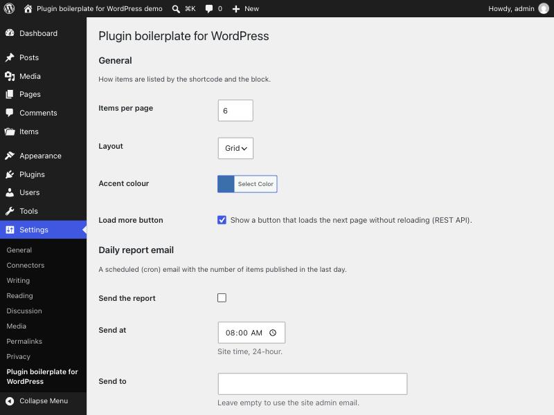
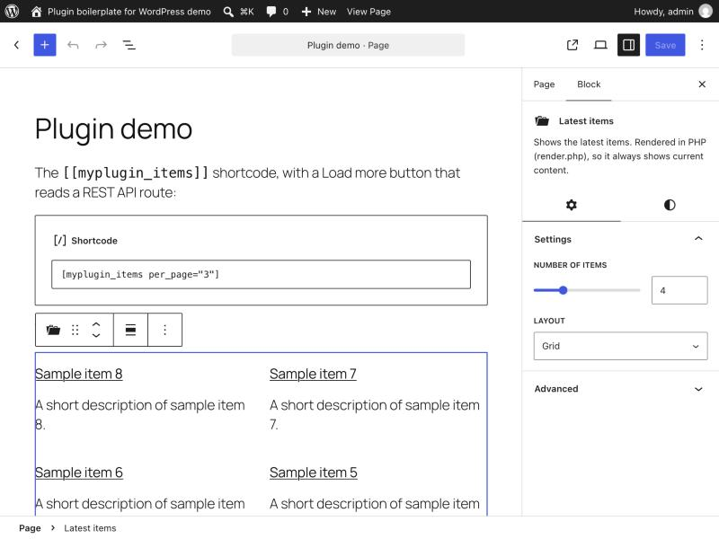
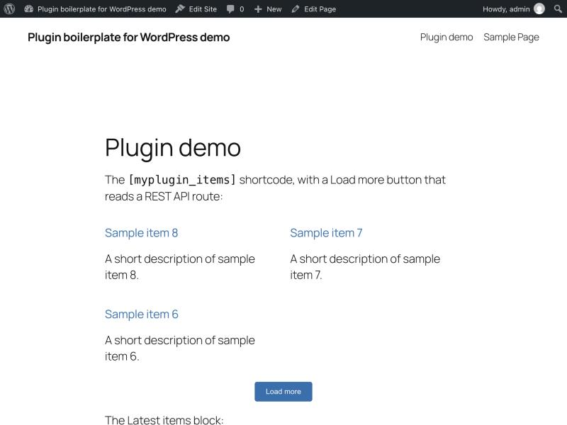
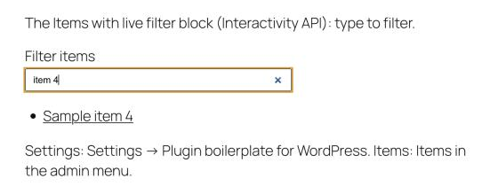

# WordPress plugin boilerplate

A starter kit for WordPress plugins that is ready on day one: a clean,
namespaced plugin with working examples, plus the whole workflow around it
(coding standards, tests, CI, automatic versioned releases and optional deploys).
Rename it with one command and start building.

[](https://github.com/wpgenius/wordpress-plugin-boilerplate/releases/latest)
[](https://playground.wordpress.net/?blueprint-url=https://raw.githubusercontent.com/wpgenius/wordpress-plugin-boilerplate/main/.wordpress-org/blueprints/blueprint.json)
[](https://github.com/wpgenius/wordpress-plugin-boilerplate/actions/workflows/ci.yml)
[](LICENSE)

## What you get

**A plugin you can keep, change or trim**
- Namespaced classes in `src/`, one per concern (admin, front end, AJAX, cron,
  post types, blocks), all sharing one `Api` helper class. No Composer needed
  at runtime: it runs straight from a clone or a zip.
- A **settings page built from one array**: add a field in one line and get it
  registered, sanitised, rendered and readable with `get_setting()`.
- Working examples: a custom post type with an admin column, a REST API route,
  a shortcode with a "Load more" button that uses it, an admin-ajax action,
  a dynamic block and an interactive block built with the Interactivity API, a dynamic block, a scheduled email with
  `{placeholders}`, theme-overridable templates, and a "View details" popup for
  plugins that aren't on WordPress.org.
- Activation, upgrades and an uninstall that only deletes data when asked.
  Multisite aware: network activation and deactivation run on every site, and
  sites added later are set up too.

**The workflow around it**
- WordPress Coding Standards, PHPStan static analysis, PHP compatibility
  (7.4–8.5), unit tests, JS/CSS lint and WordPress Plugin Check, all run on
  every pull request.
- **Automatic releases:** merge a pull request and, if the plugin changed, a new
  version is tagged, the changelog is written from the closed issues, and a
  zip is published. Docs-only changes don't make a release.
- **Optional deploys** to FTPS, SSH or WordPress.org, behind an on/off switch.
- A protected `main` branch, issue-linked pull requests, Dependabot, and a
  one-command GitHub setup.
- A local WordPress in Docker, and a rename script so the first five minutes
  are easy.

## Screenshots

| Settings page built from one array | Block with its settings in the editor |
|---|---|
|  |  |

| Front end: shortcode with Load more (REST API) | Interactivity API block filtering as you type |
|---|---|
|  |  |

All taken in the [Playground demo](#try-it-in-your-browser).

## Why this boilerplate

Most boilerplates give you folders. This one gives you a plugin that already
works, following WordPress best practices (escaping, nonces, capabilities,
i18n, dbDelta, block.json), and the release process most teams build by hand
later. Everything is plain PHP and shell, readable in an afternoon, with no
framework to learn.

## Try it in your browser

[**Open the demo in WordPress Playground**](https://playground.wordpress.net/?blueprint-url=https://raw.githubusercontent.com/wpgenius/wordpress-plugin-boilerplate/main/.wordpress-org/blueprints/blueprint.json):
a full WordPress site that runs in your browser, with the latest release installed,
sample items and a demo page. Nothing to install; you are logged in as admin, so
you can open the settings page and the block editor too. The demo is described in
[`.wordpress-org/blueprints/blueprint.json`](.wordpress-org/blueprints/blueprint.json),
and WordPress.org uses the same file for the "Live Preview" button if you publish there.
For your own plugin, the demo works once the repo is public and has a release
(Playground downloads `releases/latest/download/<slug>.zip`).

## Start a new plugin

You need `git`, `perl` (both preinstalled on macOS and Linux) and, for step 4,
the [GitHub CLI](https://cli.github.com) signed in with `gh auth login`.
The examples create a plugin called **Acme Events**; use your own names.

### 1. Get the code

Either click **Use this template** on GitHub and clone your new repo, or clone this
one and start a fresh history:

```bash
git clone https://github.com/wpgenius/wordpress-plugin-boilerplate.git acme-events
```

```bash
cd acme-events && rm -rf .git && git init -b main
```

### 2. Rename the plugin

From the plugin folder, run:

```bash
bin/rename.sh
```

It asks for the plugin name, a one-line description and the author, suggests
everything else, shows you the result and asks before changing anything:

```
Your plugin:
  Name            Acme Events
  Folder / slug   acme-events   (main file: acme-events.php, text domain: acme-events)
  PHP namespace   Acme\AcmeEvents   (e.g. Acme\AcmeEvents\Admin\Settings)
  Prefix          acme_events   (options, hooks, functions)   constants: ACME_EVENTS_*
                  acme-events-*   (script handles, CSS classes, URL slugs)
  Version         reset to 1.0.0, changelog emptied
```

It renames every file, class, constant, function, option, hook, block and text
domain, fills in the plugin header and resets the version to 1.0.0.

**Want a smaller start?** The script asks whether to keep the three larger
examples: the daily report email (cron and AJAX), the custom database table and
the "View details" popup for private plugins. Answer `n`, or pass `--minimal`,
and they are removed everywhere: classes, settings, scripts, uninstall and tests.
The settings page, the items post type, the REST route, the shortcode and the
blocks stay.

You can also pass everything at once, e.g. for scripts:

```bash
bin/rename.sh "Acme Events" --vendor Acme --author "Acme Inc" --github acme/acme-events --yes
```

See `bin/rename.sh --help` for every option. Afterwards, read through the plugin
header and `readme.txt`, and replace this README with your own.

### 3. Run it locally

The plugin runs straight from the checkout; no `composer install` or
`npm install` is needed to activate it (the compiled block in `build/` is
committed). To get a WordPress site for it, see
[Local development](#local-development). You can also clone straight into an
existing site's `wp-content/plugins/` folder.

### 4. Publish to GitHub and apply the repo settings

```bash
git add -A && git commit -m "Start Acme Events from wordpress-plugin-boilerplate"
```

```bash
gh repo create acme-events --private --source=. --push
```

```bash
bin/setup-github.sh
```

GitHub templates and clones copy files only, so `bin/setup-github.sh` applies the
settings once: squash-only merges, the `release:minor` / `release:major` labels,
`DEPLOY_ENABLED=false`, and a "Protect main" ruleset. The ruleset requires PRs
with a linked issue and passing CI, and lets repo admins and the release workflow (through a `release-bot` deploy key it creates) bypass it (see
[How changes ship](#how-changes-ship)). It needs admin rights on the repo and is
safe to re-run.

> **Private repo on a free GitHub plan?** GitHub enforces rulesets on private
> repos only on paid plans (Pro, Team or Enterprise). On a free plan the script
> stops at the ruleset step and says so; everything else is applied. Use a
> public repo or a paid plan to protect `main`.

The first push to `main` publishes **v1.0.0** ("Initial release") with the plugin
zip; the version comes from the plugin header you reset in step 2. From then on, every change follows
the flow below: open an issue, branch, PR, merge.

## Your first feature in 10 minutes

A small, complete change to see how the pieces fit: one new setting, and a
shortcode that uses it. The names below are the boilerplate's; after renaming,
use your own prefix instead of `myplugin`.

**1. Add a setting.** In `src/Admin/Settings.php`, add one entry to the
`general` section of `fields()`:

```php
'greeting' => array(
	'type'    => 'text',
	'label'   => __( 'Greeting', 'wordpress-plugin-boilerplate' ),
	'default' => 'Hello',
),
```

That is all a setting needs. It is now shown on the settings page, sanitised
when saved, and readable anywhere with `get_setting( 'greeting' )`.

**2. Add a shortcode.** In `src/Frontend/Shortcodes.php`, register it in the
constructor:

```php
add_shortcode( 'myplugin_hello', array( $this, 'render_hello' ) );
```

and add its method to the class:

```php
/**
 * [myplugin_hello name="Asha"]
 *
 * @param array|string $atts Shortcode attributes.
 * @return string
 */
public function render_hello( $atts ) {
	$atts = shortcode_atts( array( 'name' => 'world' ), $atts, 'myplugin_hello' );

	return '<p>' . esc_html( self::get_setting( 'greeting' ) . ', ' . $atts['name'] . '!' ) . '</p>';
}
```

**3. Try it.** Open **Settings → (your plugin)**: the Greeting field is there.
Put `[myplugin_hello name="Asha"]` on a page and view it: "Hello, Asha!".
Change the greeting, save, reload.

**What you just used**
- The settings array: one entry gives you the field, its saving and its default.
- `self::get_setting()`: every class extends `Api`, which holds the shared helpers.
- `shortcode_atts()` and `esc_html()`: give attributes a default, and escape
  everything you print.

**Next:** run `composer phpcs` to check the code style (`composer phpcbf` fixes
small things, like the alignment of the new array entry), then ship it the way
every change ships: issue, branch, pull request (see [How changes ship](#how-changes-ship)).
`src/Plugin.php` lists every part that is loaded; see
[Plugin structure](#plugin-structure) for how to remove an example.

## Local development

**WordPress in Docker** (mounts this repo as the plugin):

```bash
cp .env.example .env
```

```bash
docker compose up -d
```

WordPress runs at http://localhost:8000 and phpMyAdmin at http://localhost:8080.
Change `WP_HTTP_PORT` / `PMA_HTTP_PORT` in `.env` if those ports are taken.

**Code checks** (Composer and npm are for development tools only):

```bash
composer install
```

| Command | What it does |
|---|---|
| `composer lint` | PHP syntax check |
| `composer phpcs` / `composer phpcbf` | WordPress Coding Standards (check / auto-fix) |
| `composer phpstan` | Static analysis: wrong types, missing methods, unchecked `false`/`WP_Error` (level in `phpstan.neon.dist`) |
| `composer test` | Unit tests (PHPUnit + Brain Monkey, no WordPress needed) |
| `npm run env -- start` then `npm run test:integration` | Integration tests in a real WordPress (wp-env, needs Docker): activation, uninstall, REST, AJAX permissions. `npm run test:integration:multisite` runs them as a network. `npm run env -- stop` when done |
| `composer make-pot` | Regenerate `languages/*.pot` |
| `npm ci` | Install the JS tools |
| `npm run build` / `npm start` | Build the blocks into `build/` (once / watch) |
| `npm run lint` | JS and CSS lint |

Commit `build/` after changing a block; CI fails if it is out of date.

## How changes ship

```
issue  →  branch  →  pull request (Closes #N)  →  squash merge to main  →  automatic release  →  deploy (if enabled)
```

- **`main` is protected.** Changes go through pull requests, merged with squash.
  Repository admins can still bypass the rules (e.g. a quick edit on GitHub).
- **Every PR closes an issue** (you can switch this off: `bin/setup-github.sh --linked-issue off`). The *Linked issue* check fails a PR whose
  description has no `Closes #N`. One request with several changes = one issue per
  change, delivered in one PR.
- **CI** runs on every PR and must pass before merging: PHP 7.4–8.5 syntax, unit tests, integration tests in WordPress (lowest supported and latest), PHPCS, PHPStan, JS/CSS lint, block build and WordPress Plugin Check.
  Plugin Check fails when `Tested up to` in `readme.txt` is behind the latest WordPress,
  so bump it after testing each new WordPress version. In the boilerplate itself it
  also warns about the placeholder names ("plugin" in the name, the `myplugin_`
  prefix); those warnings go away once you run `bin/rename.sh`.
- **Releases are automatic.** On each merge to `main`, the
  [Release workflow](.github/workflows/release.yml):
  1. releases only if the plugin zip would change: it compares the package
     (everything [`.distignore`](.distignore) doesn't exclude) with the last
     release. Docs, CI and config changes don't release;
  2. bumps the version: patch by default, or minor/major when the PR has the
     `release:minor` / `release:major` label;
  3. writes the changelog (one line per closed issue) and the new version into
     `readme.txt` and the plugin header, and commits that to `main`;
  4. tags the commit and publishes a GitHub release with the plugin zip
     (`releases/latest/download/<slug>.zip`).
- **Deploys are off by default.** See below.

## Deploys

The [Deploy workflow](.github/workflows/deploy.yml) runs after each release while
the repo variable `DEPLOY_ENABLED` is `true`. Choose the target with `DEPLOY_METHOD`:

| `DEPLOY_METHOD` | Target | Settings (variables / secrets) |
|---|---|---|
| `ftps` | FTP with TLS (shared hosting) | `FTP_PORT`, `FTP_REMOTE_PATH`, `FTP_SSL_VERIFY` / `FTP_HOST`, `FTP_USERNAME`, `FTP_PASSWORD` |
| `ssh` | rsync over SSH | `SSH_PORT`, `SSH_REMOTE_PATH`, `SSH_DELETE` / `SSH_HOST`, `SSH_USER`, `SSH_PRIVATE_KEY`, `SSH_KNOWN_HOSTS` |
| `wporg` | WordPress.org plugin SVN | `WPORG_SLUG` / `SVN_USERNAME`, `SVN_PASSWORD` (banners and icons go in `.wordpress-org/`) |

To test the connection without uploading, run **Deploy** manually from the
Actions tab with *deploy* unticked.

## Bring an existing plugin or theme up to the standard

Everything under [How changes ship](#how-changes-ship) and [Deploys](#deploys) works
in any WordPress plugin or theme repo, not only in plugins started from this one.

### With Claude Code (optional)

The Claude Code plugin **[wp-repo-standard](https://github.com/wpgenius/wp-repo-standard)**
does all of this for you. Install it once:

```bash
claude plugin marketplace add wpgenius/wp-repo-standard
```

```bash
claude plugin install wp-repo-standard@wpgenius
```

Inside Claude Code the same is `/plugin marketplace add wpgenius/wp-repo-standard`
and then `/plugin install wp-repo-standard@wpgenius`. It adds two commands, available in every repo:

| Command | What it does |
|---|---|
| `/wp-repo-standard:adopt` | Audits the current plugin or theme repo against this standard, then adds the files and GitHub settings in one pull request (one issue per change). Code restructuring is only proposed. |
| `/wp-repo-standard:new` | Starts a new plugin from this boilerplate: the rename steps above, version 1.0.0, the GitHub repo and its settings. |

The commands always use the latest `main` of this repo, so changes to the standard
reach them without a plugin update. Issues and changes to the plugin itself belong in
[wpgenius/wp-repo-standard](https://github.com/wpgenius/wp-repo-standard).

### By hand

1. **Layout.** The plugin (a root `.php` file with a `Plugin Name:` header) or the
   theme (`style.css` with `Theme Name:`) must be at the repo root, not in a subfolder.
2. **Copy** from this repo, unchanged: `.github/workflows/release.yml`,
   `deploy.yml`, `linked-issue.yml`, the `.github/scripts/` folder,
   `.github/dependabot.yml` and `bin/setup-github.sh`. Delete any older release or
   deploy workflow, or every change would be released twice. CI and tooling
   (`ci.yml`, `composer.json`, `phpcs.xml.dist`, `package.json`, Docker) are optional.
3. **Ignore files.** Start from this repo's `.gitignore` and `.distignore`, then add
   your project's own rules. Anything `.distignore` doesn't exclude ships in the zip,
   so check the package contains your runtime files (`build/`, `languages/`, runtime
   `vendor/`) and nothing dev-only.
4. **readme.txt** needs a `== Changelog ==` section. For a plugin it also needs a
   `Stable tag:` equal to the header `Version:` (in `X.Y.Z` form). Themes keep their
   version in `style.css`.
5. **Versions.** Existing `vX.Y.Z` tags carry on: the next release is the next patch
   (or minor/major with a label). With no such tags, the first release takes the
   header version. If the header is ahead of your latest tag, line them up first.
6. **Merge and protect.** Open a pull request that closes an issue, merge it, and run
   `bin/setup-github.sh` (admin rights needed). Changing `.distignore` counts as
   deployable, so that merge usually makes the first automatic release.

## Plugin structure

Each area of the plugin has its own file; the folder is the area, the file is
the class. Every class extends `Api`, the shared helpers.

```
myplugin.php              header, constants, autoloader, activation hooks
uninstall.php             cleanup when the plugin is deleted
src/
├── autoload.php          WPGenius\MyPlugin\Admin\Settings → src/Admin/Settings.php
├── Plugin.php            starts every part below (admin parts only in wp-admin)
├── Api.php               shared helpers: get_setting(), verify_request(),
│                         render_template(), send_email() with {placeholders}, asset_url()
├── Installer.php         activation / deactivation, database table, upgrades
├── Rest.php              REST routes: GET /wp-json/myplugin/v1/items ("Load more")
├── Ajax.php              admin-ajax handlers ("Send a test report" button)
├── Cron.php              scheduled jobs (daily report email)
├── Admin/
│   ├── Admin.php         admin CSS/JS, Settings link on the Plugins screen
│   ├── Settings.php      settings page built from one array of fields
│   └── PluginInfo.php    "View details" popup from readme.txt (private plugins)
├── Frontend/
│   ├── Frontend.php      front-end CSS/JS
│   └── Shortcodes.php    [myplugin_items]
├── PostTypes/
│   ├── PostTypes.php     registers each post type
│   └── Example.php       "Items" post type, taxonomy, admin column
└── Blocks/
    └── Blocks.php        registers every block in build/
blocks/example/           dynamic block source (block.json, edit.js, render.php) → npm run build → build/
blocks/interactive/       Interactivity API block: render.php + view.js (data-wp-* directives)
templates/                HTML templates; themes override them in <theme>/wordpress-plugin-boilerplate/
assets/                   admin and front-end CSS/JS
languages/                translation template (.pot)
tests/Unit/               unit tests (Brain Monkey, no WordPress needed)
tests/Integration/        integration tests, run in a real WordPress with wp-env
```

**Add a setting:** one entry in `Settings::fields()`, then read it anywhere
with `self::get_setting( 'key' )` (or `Api::get_setting()`). Field types: text,
textarea, editor, number, checkbox, select, radio, email, url, color, time, password.

**REST or admin-ajax?** Use a REST route (`Rest.php`) for data the front end,
blocks or other apps read or change: arguments are validated, every route says
who may call it, and blocks call it with `wp.apiFetch`. admin-ajax (`Ajax.php`)
is fine for small one-off actions in wp-admin.

**Add a part:** create the class in `src/`, register its hooks in the
constructor, and add it to the list in `Plugin.php`.

**Remove an example:** the three optional examples are marked in the code with
`// Example: report`, `// Example: table` and `// Example: plugin-info`, on every
line or block that belongs to them. `bin/rename.sh --minimal` removes all three
when you start; later, search for a marker and delete what it marks (plus
`Cron.php` and `Ajax.php` for the report, `PluginInfo.php` for plugin-info).

## Repo files

| Path | Purpose |
|---|---|
| `readme.txt` | WordPress.org readme; version and changelog are maintained by the release workflow |
| `.distignore` | What stays out of the zip and deploys (and so never triggers a release) |
| `.github/` | CI, release, deploy, linked-issue check, Dependabot |
| `bin/rename.sh` | Turns the boilerplate into your plugin (names, namespace, version) |
| `bin/setup-github.sh` | One-time GitHub settings for a new repo |
| `CONTRIBUTING.md`, `SECURITY.md`, `.github/ISSUE_TEMPLATE/` | How to contribute and report security issues |
| `docker-compose.yml`, `.env.example` | Local WordPress + MariaDB + phpMyAdmin |
| `composer.json`, `phpcs.xml.dist`, `phpstan.neon.dist`, `phpunit.xml.dist` | PHP dev tools: coding standards, static analysis, tests |
| `package.json` | Block build and JS/CSS lint (`@wordpress/scripts`) |

## License

GPL-3.0-or-later. See [LICENSE](LICENSE).
